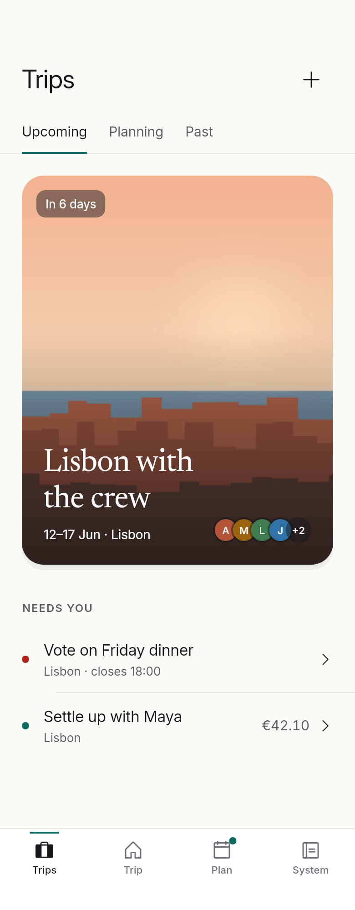
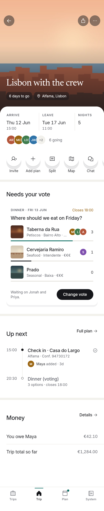
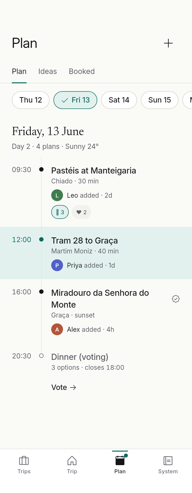
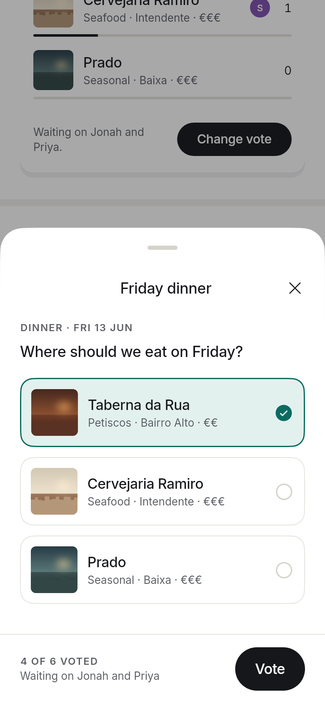

# Tripami Design System

> **Marriott Bonvoy's editorial restraint + a modern social travel diary + Apple-level utility.**
> The product UI is calmer and more refined than Tripami's marketing.

This repo is Tripami's visual design system, built for **Flutter / Dart**. It holds the research behind it, the principles and specs, design tokens, and a Flutter package with the theme and core components.

| Trips | Trip Home | Plan | Vote sheet |
|---|---|---|---|
|  |  |  |  |

Dark mode: [Trips](example/test/goldens/trips_dark.png) · [Trip Home](example/test/goldens/trip_home_dark.png) · [Plan](example/test/goldens/plan_dark.png) · [Foundations](example/test/goldens/foundations_dark.png)

The photos are generated placeholders, and the people are example data.

---

## Read in order

1. **[Bonvoy study](docs/01-bonvoy-study.md):** about 45 Marriott Bonvoy iOS screens studied on Mobbin. It explains why the app feels premium, where it falls short, and what Tripami carries over.
2. **[Principles](docs/02-principles.md):** six rules for settling design disagreements, the product-vs-marketing split, and voice.
3. **[Foundations](docs/03-foundations.md):** color, type, spacing, shape, elevation, icons, imagery, motion.
4. **[Components](docs/04-components.md):** anatomy, tokens and states for every component, with its Bonvoy reference.
5. **[Patterns](docs/05-patterns.md):** Trips, Trip Home, Plan, Decide together, Split, Memories, Invite, Onboarding, Confirmation.

## The system in one minute

- **Places and people bring the color.** Chrome is paper (`#FAFAF7`), white and ink (`#16171B`). Photos and *member colors* carry everything else.
- **The accent shows state; ink shows action.** Lagoon (`#0B6B61`) marks you / now / selected and covers at most 5% of a screen. Primary buttons are ink pills, as in Bonvoy.
- **Editorial hierarchy, set quietly.** Inter for UI with Regular large titles and uppercase eyebrows, and no Bold. Newsreader is the diary voice for trip names, day headings and memories.
- **Social presence without social noise.** Faces and names inside content ("Waiting on Jonah and Priya"), dots instead of count badges, and emoji only as reactions.
- **Utility you don't notice.** Sheets for every secondary task, a trip strip (Arrive · Leave · Nights) wherever a trip appears, 44pt targets, and AA contrast everywhere (enforced by tests).

## Using the package

```yaml
# pubspec.yaml
dependencies:
  tripami_design_system:
    git:
      url: https://github.com/chrisfoisydev/TripamiDesignSystem.git
```

```dart
import 'package:tripami_design_system/tripami_design_system.dart';

MaterialApp(
  theme: TripamiTheme.light(),
  darkTheme: TripamiTheme.dark(),
  home: const TripsScreen(),
);

// Inside a widget
final c = TPColors.of(context);
Text('Lisbon with the crew', style: TPType.display.copyWith(color: c.textPrimary));
TPButton.primary(label: 'Create trip', onPressed: createTrip);
TPAvatarStack(travelers);
Icon(TPIcons.mapPin);
```

`TripamiTheme` restyles standard Material widgets (`FilledButton`, `OutlinedButton`, `TextField`, `Switch`, `Checkbox`, `SnackBar`, `showModalBottomSheet`, dialogs) to follow the system, so plain Flutter code also stays on-brand.

### What's in `lib/`

| | |
|---|---|
| `foundations/tp_palette.dart` | Raw colors and `TPMemberColor` (8 traveler hues) |
| `foundations/tp_colors.dart` | `TPColors` `ThemeExtension`, light and dark |
| `foundations/tp_type.dart` | `TPType` scale (Inter + Newsreader, variable axes set explicitly) and the `.tabular` extension |
| `foundations/tp_layout.dart` | `TPSpace`, `TPRadius`, `TPSize`, `TPElevation`, `TPMotion` |
| `foundations/tp_icons.dart` | `TPIcons` / `TPIconsFill`, a curated Phosphor set |
| `theme/tp_theme.dart` | `TripamiTheme.light()` / `.dark()` |
| `components/` | `TPButton`, `TPGlassIconButton`, `TPQuickAction`, `TPFloatingPill`, `TPEyebrow`, `TPSectionHeader`, `TPAvatar`, `TPAvatarStack`, `TPAttribution`, `TPActivityDot`, `TPReactionBar`, `TPCard`, `TPGlassChip`, `TPTripCoverCard`, `TPTripStrip`, `TPListRow`, `TPSectionBand`, `TPStickyActionBar`, `TPEmptyState`, `showTPSheet`, `TPTabBar`, `TPUnderlineTabs`, `TPFilterChip`, `TPPollCard`, `TPItineraryItem`, `TPExpenseRow` |

Fonts are bundled (`lib/fonts/`): Inter and Newsreader (SIL OFL) and Phosphor Icons (MIT). Their licenses sit next to the files. SF Pro and New York aren't used because Apple licenses them for Apple platforms only.

Requires Flutter ≥ 3.32 (for `RoundedSuperellipseBorder`). Tested on Flutter 3.47.6.

## Development

```sh
flutter analyze                 # package
flutter test                    # contrast + unit tests (WCAG AA for every allowed pairing)

cd example
flutter test                    # screenshot (golden) tests, light and dark
flutter test --update-goldens   # regenerate screenshots after a visual change
flutter create --platforms=ios,android .   # once, to add runners, then:
flutter run
```

Golden tests load the real fonts and turn shadows on, so the screenshots match the device. The test renderer has no emoji font, so reaction emoji show as boxes in screenshots only.

`tokens/tokens.json` is the W3C design-tokens source for design tools. If you change a value, update `tp_palette.dart` / `tp_type.dart` / `tp_layout.dart` to match.
